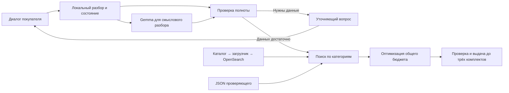

# Архитектура поиска Avito SmartSet

Для первого эксперимента на **1 млн активных объявлений** предлагается гибридная архитектура. **OpenSearch находит кандидатов, Python проверяет обязательные условия и собирает комплекты, Gemma разбирает диалог.** Начальная версия использует точные фильтры, поиск по цене и BM25. Векторный поиск имеет смысл включать после измерения качества выдачи на пользовательских формулировках, где BM25 теряет подходящие объявления.

Хакатонный `./run --catalog …` продолжает работать с переданным JSON и шлюзом организаторов. Масштабируемый поиск получает каталог из заранее построенного индекса через отдельный внутренний интерфейс. Цель эксперимента — оценить задержку от запроса до результата и выяснить, при какой нагрузке она укладывается в несколько секунд. На этом этапе выполнено проектирование, замеры производительности предстоят.

## 1. Исходное состояние и совместимость

В версии `dd01529` CLI считывает историю и каталог, Gemma возвращает типизированные условия, а локальный словарь помогает распознать категории. Поиск проходит по всем полученным объявлениям, фильтрует их, сортирует подходящие по цене и использует очередь с приоритетом для трёх самых дешёвых комплектов. Проверка характеристик, учёт неизвестных значений, объяснения и разделение ошибок от `no_match` пригодны для повторного использования. Загрузка каталога целиком и лимит в 250 записей относятся к проверочному пути. Веб-демо использует то же ядро и локальный HTTP-сервер. [CLI](https://github.com/ashuklin08/cyber-garden/blob/dd01529/buyer/cli.py) · [Валидация](https://github.com/ashuklin08/cyber-garden/blob/dd01529/buyer/contracts.py) · [Подбор](https://github.com/ashuklin08/cyber-garden/blob/dd01529/buyer/selection.py) · [Разбор категорий](https://github.com/ashuklin08/cyber-garden/blob/dd01529/buyer/anchors.py)

| Граница | Требования и решение |
| --- | --- |
| Проверка организаторов | Исполняемый `run` в корне, Linux и Bash, каталог по аргументу, один объект из stdin и один объект в stdout. Вход по прежней схеме `messages`, выход строго `ok`, `clarify` или `no_match`. Технические сбои идут в stderr с ненулевым кодом. Лимит вызова — 120 с. |
| Модель хакатона | Сохраняются `google/gemma-4-31B-it` и четыре переменные окружения. Gateway допускает до двух параллельных вызовов и 20 попыток за скользящие 60 секунд на команду, до 32 768 байт текста и 65 536 байт запроса. Все замеры с Gemma соблюдают эти ограничения. |
| Путь большого каталога | Долгоживущий Python-сервис, индекс и отдельный загрузчик. Новый формат состояния существует внутри backend. Для хакатона он преобразуется в существующие типы и проверяется схемами организаторов. |
| Источник фактов | Формальные поля каталога определяют цену, город и наличие характеристики. Тексты объявлений участвуют в оценке релевантности. В LLM передаются реплики покупателя и состояние диалога. |

[Контракт 1.1](https://github.com/K0STYAa/sfedu-hackathon-buyer-assistant/blob/e5c90f5/CONTRACT.md) · [Контракт API Gemma](https://github.com/K0STYAa/sfedu-hackathon-buyer-assistant/blob/e5c90f5/LLM_API.md)

## 2. Компоненты системы



Внутренний интерфейс поиска принимает валидированные условия категории. Он поддерживает три операции: получить самые дешёвые объявления, получить релевантные объявления и загрузить карточки по выбранным ID. Адаптер проверочного JSON реализует их локально. Адаптер большого каталога отправляет пакет запросов в индекс. Валидатор и правила комплектации общие для обоих путей. Для первого эксперимента достаточно Python и HTTP-клиента к OpenSearch. Язык написания сервиса можно выбирать независимо от движка, поскольку поиск по индексу выполняется внутри OpenSearch.

## 3. Понимание запроса и состояние диалога

Как исходную гипотезу качества сравниваем **LLM для каждого запроса** с **локальным разбором и LLM для смысловых случаев**. Для сравнения обе схемы получают одинаковый набор размеченных диалогов и используют одну схему условий. В хакатонном CLI Gemma участвует в обработке запроса согласно контракту. В будущем сервисе однозначный запрос может пройти локально после подтверждения точности на отложенной выборке.

| Что извлекать | Что делает backend | Где нужна Gemma |
| --- | --- | --- |
| Намерение и категории | Нормализует словоформы и синонимы, выделяет явные категории и команды «добавь», «убери», «только». Пограничные словосочетания остаются кандидатами. | Понимает косвенные формулировки, альтернативы, отрицание и ссылки на предыдущий результат. |
| Город и бюджет | Сопоставляет названия и алиасы со справочником. Парсит числа, `₽`, «тыс.» и «к». Различает цену позиции и бюджет комплекта, когда это прямо указано. | Разрешает конфликт городов, неявную смену бюджета и неполные ответы с контекстом. |
| Характеристики | Парсит единицы и явные границы. «Не шире метра» даёт `width_cm <= 100`, «уже метра» — `width_cm < 100`. Сравнения идут в канонических единицах с точной арифметикой. | Связывает обособленное условие с нужной категорией и отличает характеристику от назначения товара. |
| Обязательность | Помечает явно выраженный предел, запрет или обязательное значение. Проверяет тип, оператор, допустимый атрибут и совместимость с категорией. | Отделяет «обязательно» от «желательно» в сложной фразе. «Удобное кресло» остаётся пожеланием, если критерий удобства не задан. |

На вход Gemma поступают короткая инструкция, последняя реплика, структурированное состояние и нужные для ссылки предыдущие реплики. Для CLI исходная история каждый раз доступна из входного JSON. При сжатии сохраняем фрагменты, на которые опираются обязательные условия, предыдущий вопрос и упомянутый вариант, если пользователь на него ссылается. Локальный разбор сохраняет происхождение каждого подтверждённого значения. При конфликте между локальным прочтением и моделью запрашиваем уточнение, если конфликт меняет допустимость результата. В пределах запроса отбрасываем повторения, сохраняя отрицания, диапазоны, области действия и последние явные исправления.

Пример внутреннего представления запроса со столом, креслом и лампой:

```json
{
  "intent": "find_bundle",
  "city_id": "taganrog",
  "categories": ["table", "chair", "lamp"],
  "budget_rub": 15000,
  "constraints": [
    {"category": "table", "attribute": "width_cm", "operator": "<=", "value": 100, "required": true}
  ],
  "preferences": [
    {"category": "table", "text": "компьютерный"},
    {"category": "chair", "text": "удобное"},
    {"category": "lamp", "text": "настольная"}
  ]
}
```

На каждом ходе сервер применяет валидированные операции установки, удаления или замены к конкретным полям. Значение «12 тысяч» в ответ на вопрос о бюджете меняет только `budget_rub`. «Ширина не важна» удаляет соответствующее сравнение. В продуктовом сервисе версия состояния защищает от применения двух ответов в неверном порядке. В CLI состояние воспроизводится из входного диалога. Если отсутствует город, бюджет или состав, CLI возвращает вопрос по каждому отсутствующему полю. Неоднозначный обязательный атрибут в продуктовом диалоге может потребовать отдельного уточнения. Хакатонный JSON использует только разрешённые поля вопросов. [Правила истории и уточнений](https://github.com/K0STYAa/sfedu-hackathon-buyer-assistant/blob/e5c90f5/CONTRACT.md#3-запрос-и-история)

## 4. Сравнение технологий

Оценки ниже описывают ожидаемые свойства вариантов. Одинаковую задержку, пропускную способность и стоимость сравниваем на одном наборе данных и запросов.

| Вариант | Задержка и фильтрация | Ранжирование | Память, масштаб, стоимость и интеграция |
| --- | --- | --- | --- |
| Собственный движок на TypeScript | Низкие накладные расходы внутри одного процесса при компактных индексах. Для CPU-параллельности нужны рабочие потоки и совместное использование или разделение данных. Служебную логику индексов придётся реализовать самим. | Свои BM25, анализ текста, порядок сортировки, объединение результатов и измерение качества. | Типизированные массивы экономнее графов JS-объектов. Потребуются форматы сегментов, обновления и восстановление, контроль памяти, репликация и новый сервис рядом с Python. Высокая инженерная стоимость на 10 млн и дальше. [Node.js Worker threads](https://nodejs.org/api/worker_threads.html) |
| OpenSearch или Elasticsearch как поисковый движок | Готовые текстовые и точные индексы, числовые фильтры, параллельная работа шардов. Сетевой вызов и рассеивание запросов по шардам увеличивают накладные расходы. | BM25, сортировка и векторные возможности. Оптимизацию комплекта под общим бюджетом удобнее считать в приложении. | JVM, диск, файловый кэш, нагрузка при слиянии сегментов и стоимость реплик. Интеграция через HTTP. Сравниваем выбранные версии и конфигурации, включая условия эксплуатации и стоимость инфраструктуры. [OpenSearch Similarity](https://docs.opensearch.org/latest/im-plugin/similarity/) · [Elasticsearch Search shard routing](https://www.elastic.co/docs/reference/elasticsearch/rest-apis/search-shard-routing) |
| OpenSearch и собственное Python-ядро | Пакетные запросы по категориям. Движок отбирает кандидатов, Python обрабатывает ограниченные списки. | BM25 и предпочтения на уровне объявления, точный решатель комплекта в пределах пула. | Стоимость поискового кластера плюс лёгкий сервис. Можно переиспользовать текущий CLI, валидаторы и модель. Усложнение по сравнению с одной БД оправдано, если тесты подтверждают ценность поиска и горизонтального масштабирования. **Основной вариант.** |
| PostgreSQL или SQLite FTS5 | PostgreSQL хорошо подходит как контроль для составных условий и цены. SQLite позволяет запустить воспроизводимый стенд на одном узле. Нужно проверить планы запросов при сочетании широких фильтров, текста и сортировки. | PostgreSQL GIN и штатное ранжирование полнотекста. SQLite FTS5 даёт BM25. Для PostgreSQL сочетание текстового и отдельного структурного индекса зависит от плана. | Проще начать. SQLite удобен для локального сравнения и чтения. PostgreSQL может служить источником записей. Рост полнотекстовой нагрузки и горизонтальное распределение требуют отдельной проверки. [PostgreSQL B-tree и bitmap](https://www.postgresql.org/docs/current/indexes-bitmap-scans.html) · [PostgreSQL GIN](https://www.postgresql.org/docs/current/textsearch-indexes.html) · [SQLite FTS5](https://sqlite.org/fts5.html) |

**Почему OpenSearch первым.** Он даёт один индекс для числовых ограничений и текстовой релевантности, поддерживает поиск по нескольким запросам за один HTTP-вызов и даёт путь к шардам и репликам. Для текущей команды дополнительная логика сосредоточена в извлечении кандидатов и комплектации. Elasticsearch остаётся сопоставимым вариантом при наличии собственной инфраструктуры и опыта. PostgreSQL со структурным индексом и полнотекстом служит основным контрольным вариантом. Если он укладывается в целевые задержку, свежесть и качество при меньшей стоимости, его можно выбрать для первого развёртывания. [OpenSearch Multi-Search](https://docs.opensearch.org/latest/api-reference/search-apis/multi-search/) · [PostgreSQL Multicolumn Indexes](https://www.postgresql.org/docs/current/indexes-multicolumn.html)

## 5. Данные и индексы

Один документ индекса соответствует одному объявлению. Стабильный `listing_id` связывает его с источником данных. Пример полей — `city_id`, `category_id`, `active`, `price_rub`, `width_cm`, `color_temperature_k`, `adjustable_height`, `title`, `description`, `version`, `updated_at`. Для будущих категорий индексируем только утверждённые для фильтрации поля. Единицы измерения и типы хранятся в версии справочника. Для поля без подтверждённого значения сохраняем отсутствие. Значение `false` у булевого поля известно и отличается от отсутствия поля.

| Механизм | Место в SmartSet |
| --- | --- |
| Инвертированный индекс | Основной механизм текста. Сопоставляет термы с документами, чтобы искать совпадения по словарю и спискам документов. Заголовок и короткое описание индексируются раздельно. Стартуем с русского анализатора. Точные бренды, модели и артикулы получают отдельные поля при появлении этих данных. [Русский анализатор OpenSearch](https://docs.opensearch.org/latest/analyzers/language-analyzers/russian/) |
| BM25 | Стартовое ранжирование текста внутри категории. Большее влияние заголовка и вес конкретных предпочтений настраиваем на размеченных запросах. Обязательные условия идут в фильтр. Текстовые пожелания повышают оценку, поэтому допустимые объявления с нулевым совпадением сохраняют шанс на выдачу. [OpenSearch Similarity](https://docs.opensearch.org/latest/im-plugin/similarity/) · [Boolean query](https://docs.opensearch.org/latest/query-dsl/compound/bool/) |
| B-tree, B+ tree и BKD | В SQL-контроле проверяем B-tree по `(city_id, category_id, price_rub, listing_id)` на активных товарах. Упорядоченные деревья подходят для диапазона и чтения первых строк. В Lucene диапазоны опираются на числовые поля и BKD, а сортировка использует соответствующие значения документов. Сортировка индекса по городу, категории и цене — отдельный эксперимент с учётом стоимости записи. [Lucene BKD](https://lucene.apache.org/core/10_3_1/core/org/apache/lucene/util/bkd/BKDWriter.html) · [Doc values](https://docs.opensearch.org/latest/mappings/mapping-parameters/doc-values/) · [Elastic Index sorting](https://www.elastic.co/docs/reference/elasticsearch/index-settings/sorting) |
| Bitmap | Подходит для пересечения плотных множеств по низкокардинальным признакам. Используем режим фильтров движка и измеряем попадания в кэш. Для SQL измеряем bitmap scan. Отдельные, например сжатые Roaring-индексы, оправданы лишь при подтверждённом узком месте и с учётом стоимости синхронизации при записи. [PostgreSQL Bitmap scans](https://www.postgresql.org/docs/current/indexes-bitmap-scans.html) |
| Хеш-индекс | Справочники и точное сопоставление ID в Python. Ключ объявления полезен для дедупликации и доступа к карточке. Диапазон цены и порядок выдачи обеспечивают упорядоченные структуры. |
| Vector Search | Поздний эксперимент. Сначала сравниваем семантическую переоценку небольшого пула с добавлением отдельных векторных кандидатов. Для ANN используем фильтры внутри запроса к k-NN, чтобы город и ограничения участвовали в извлечении. Векторный модуль требует отдельного источника эмбеддингов, поскольку API Gemma в кейсе описывает Chat Completions. [OpenSearch k-NN filtering](https://docs.opensearch.org/latest/vector-search/filter-search-knn/efficient-knn-filtering/) |
| Hybrid и Multi-stage Retrieval | Первый релиз объединяет дешёвые и текстовые варианты, затем считает предпочтения и комплект. В расширении можно объединить текст и ANN через RRF по позициям в списках. Дешёвые объявления сохраняются отдельной веткой для выполнимости бюджета. [OpenSearch RRF](https://docs.opensearch.org/latest/vector-search/ai-search/hybrid-search/rrf/) |
| Distributed Search | Храним части индекса на шардах и добавляем реплики для доступности и чтения. В больших каталогах маршрутизируем по городу или региону только после измерения распределения, чтобы ограничить число участвующих шардов и избежать перегрузки крупного города. [OpenSearch Index settings](https://docs.opensearch.org/latest/install-and-configure/configuring-opensearch/index-settings/) · [Elasticsearch Routing](https://www.elastic.co/docs/reference/elasticsearch/mapping-reference/mapping-routing-field) |

Применяем явный mapping. Точные признаки храним как `keyword` или `boolean`, цену — как целое `long`. В первой схеме у характеристик целочисленные значения, а границы покупателя могут быть дробными. Например, `width_cm < 100{,}5` для целых ширин эквивалентно `width_cm <= 100`. Нижние, верхние и точные границы переводим без потери смысла, пустые диапазоны обнаруживаем до поиска. На ранней стадии выгружаем только ID, цену, версию, оценку и проверяемые атрибуты. Заголовки и другие поля отображения запрашиваем для финальных ID. Не создаём полный Python-объект для каждой записи большого каталога на запросе. [OpenSearch Numeric field types](https://docs.opensearch.org/latest/mappings/supported-field-types/numeric/)

## 6. Поиск от JSON до комплекта

1. **Проверить условия.** Нормализовать город, набор категорий, диапазоны и бюджет. Скомпилировать для каждой категории фильтр активных объявлений с точным городом и категорией. Для каждого обязательного атрибута включить проверку наличия и само сравнение. Для `adjustable_height=false` требуется явное значение `false`.
2. **Найти точный минимум цены.** В первом пакете запросить по три объявления каждой категории по `(price_rub ASC, listing_id ASC)` с обязательными фильтрами. Этот шаг ещё не ограничивает цену общим бюджетом, поэтому отличает отсутствие товаров от недостатка денег. Запросы пакета используют один снимок индекса. Для OpenSearch проверяем применение PIT к выбранной версии, отключаем или отбрасываем частичные результаты и контролируем тайм-ауты каждого подзапроса. [OpenSearch PIT](https://docs.opensearch.org/latest/search-plugins/searching-data/point-in-time/) · [Search API](https://docs.opensearch.org/latest/api-reference/search-apis/search/)
3. **Проверить существование решения.** Если у категории нет кандидатов, полного комплекта нет в этом снимке. Если минимум в каждой категории равен `m_i`, то точная минимальная стоимость комплекта `M = Σ m_i`. При `M > B` ответ объясняет недостачу `M - B`. При `M <= B` первые товары всех категорий уже образуют допустимый комплект. Тайм-аут, ошибка шарда или неполный ответ дают техническую ошибку либо возврат ранее целиком проверенного результата в допустимом продуктовом режиме. Отсутствие результата можно утверждать только после успешной проверки всех категорий.
4. **Сузить диапазоны и извлечь кандидатов.** Верхняя цена любого товара в категории `i` равна `cap_i = B - (M - m_i)`, поскольку остальные позиции не могут стоить меньше своих минимумов. При отсутствии предпочтений достаточно первых трёх дешёвых объявлений на категорию. При наличии предпочтений второй пакет использует прежний снимок, фильтр и `cap_i`, извлекает, например, по 32 самых дешёвых и 64 лучших по тексту товара на категорию. Числа служат начальными параметрами эксперимента. Если структурированные предпочтения требуют отдельных подзапросов, включаем найденные по ним варианты в тот же пул. Дедуплицируем по ID. Всегда сохраняем точные минимумы.
5. **Ранжировать позиции.** Считаем оценку `u = w_text × text_score + Σ w_j × preference_j`. Для первого эксперимента `text_score = BM25 / (BM25 + c)`, где `c > 0` фиксируется для категории на обучающей части разметки, а `preference_j` лежит в диапазоне от 0 до 1. При сравнении размеров пула используется одна версия формулы. Если объявление пришло только через список по цене, его текстовую оценку при необходимости считаем пакетно для этих ID на том же снимке. Это позволяет корректно сравнивать качество пула с эталоном. Подключаем семантическую оценку после проверки прироста качества и задержки.
6. **Собрать комплекты и подтвердить выдачу.** Решатель использует сохранённые цены и характеристики. Перед ответом проверяем уникальность ID, число категорий, город, наличие и значения всех обязательных полей, активность и сумму целых цен. Если при гидратации карточек обнаружена более новая версия, перепроверяем изменённые позиции. При необходимости повторяем поиск на новом снимке в пределах оставшегося времени. В объяснение включаем проверенные факты и сумму по позициям.

**Почему алгоритм не перебирает каталог при каждом запросе.** Движок выполняет запросы по текстовым спискам документов и числовым индексам, а в приложение передаёт ограниченные выборки. Отбор самых дешёвых обходится без подсчёта полного числа совпадений. Широкие фильтры или частые текстовые термы всё равно могут потребовать обработки многих документов внутри шарда. Такие запросы входят в нагрузочный тест отдельно.

Например, запрос минимума для стола шириной до 100 см содержит только проверяемые поля. Этот объект можно использовать как тело одного подзапроса. В рабочем пакете backend добавляет ссылку на выбранный снимок.

```json
{
  "size": 3,
  "track_total_hits": false,
  "_source": ["listing_id", "city_id", "category_id", "price_rub", "width_cm", "active", "version"],
  "sort": [{"price_rub": "asc"}, {"listing_id": "asc"}],
  "query": {
    "bool": {
      "filter": [
        {"term": {"city_id": "taganrog"}},
        {"term": {"category_id": "table"}},
        {"term": {"active": true}},
        {"exists": {"field": "width_cm"}},
        {"range": {"width_cm": {"lte": 100}}}
      ]
    }
  }
}
```

## 7. Оптимизация комплектов

Цель при отсутствии предпочтений — минимальная суммарная цена. При наличии предпочтений цель — максимум суммы оценок выбранных позиций под общим бюджетом, затем меньшая цена и стабильный порядок ID. Вес критериев фиксируем до комплектации. Так алгоритм отличает допустимость от привлекательности.

**Режим минимальной цены.** Переиспользуем очередь с приоритетом из текущего проекта. Начинаем с первых позиций отсортированных списков, извлекаем комплект с минимальной суммой и добавляем соседей, в которых одна позиция заменена следующей по цене. Для трёх результатов достаточно первых трёх товаров каждой категории при согласованном порядке цены и ID. Любой комплект с четвёртой позицией в одной категории имеет как минимум три предшествующие замены этой позиции. Извлечение ограничивается тремя комплектами или первой ценой выше бюджета.

**Режим предпочтений для трёх категорий.** Для двух категорий с наименьшим произведением размеров пула перебираем пары и сортируем их по сумме. Для каждого префикса запоминаем три пары с лучшей суммой оценок и правилом разрешения ничьих. Для объявления третьей категории бинарным поиском находим крайний префикс, который помещается в оставшийся бюджет. Его три лучшие пары дают все варианты, способные войти в глобальные три лучших внутри пула. Сравниваем результаты для всех товаров третьей категории. Для одной категории достаточно сортировки, для двух — поиска по бюджету по одной из категорий. При размере списков до `K` время для трёх категорий порядка `O(K² log K)`, память — `O(K²)`. На тестах валидируем порядок и точные суммы через полный перебор небольших пулов, включая ничьи и бюджет ровно по границе.

Например, при бюджете 15 000 ₽ самые релевантные стол, кресло и лампа стоят соответственно 8 000, 7 000 и 2 000 ₽. Такой комплект недопустим. Стол за 6 000 ₽ с теми же креслом и лампой укладывается в 15 000 ₽. Решатель сравнивает эту замену с альтернативным креслом и остальными допустимыми сочетаниями.

Доказательство наличия или отсутствия доступного комплекта опирается на точные минимумы по всему снимку. Оптимальность по предпочтениям гарантируется внутри извлечённого пула. Для проверки качества по всему каталогу сравниваем решения при нескольких размерах пула с эталоном. Для большего числа категорий следующий эксперимент — множественный выбор с ограничением бюджета через поиск с отсечениями. Остаточный минимум цены отсекает невозможные ветви, а сумма максимумов оценки по оставшимся категориям задаёт верхнюю границу. При лимите времени сохраняем лучший проверенный комплект и отражаем степень оптимальности во внутренней диагностике.

## 8. Масштабирование и обновления

| Масштаб | Стартовая конфигурация и решение о росте |
| --- | --- |
| 1 000–100 000 | Один узел, один первичный шард. Сравнение с текущим алгоритмом на расширяемом стенде и с SQL. Проверяем накладные расходы API, индекса и комплектации. |
| 1 млн | Стартовый замер на одном узле с NVMe, одним первичным шардом и без реплики для изоляции затрат. Затем замер на нескольких узлах с репликой, чтобы учитывать пропускную способность, отказ и реальную стоимость. |
| 10 млн | Сравнить 1, 3 и 6 первичных шардов и измерить распределение городов, P95, нагрузку диска и время восстановления. Проверить маршрутизацию на запросах с популярными и редкими городами. Число шардов определяется измерением на сопоставимом суммарном оборудовании. |
| 100 млн и выше | Разделить индекс на региональные группы с независимым поиском и темпом обновлений. Крупные города разбиваются на несколько шардов по стабильному хешу ID. Запросы города обращаются только к его группе. Переход подтверждают замеры пропускной способности, восстановления после отказа узла и нагрузки перекошенных разделов. |

**Память.** Выделяем часть RAM под JVM, часть под файловый кэш ОС. Замеряем heap, RSS процессов, доступную память, файловый кэш и объём индекса раздельно. Ограничиваем размеры пакетов, пулов и число одновременных обращений к шардам. У описаний ограничиваем индексируемое поле, измеряя влияние на качество. Пример нижней границы размера эмбеддингов: миллион векторов по 384 компоненты `float32` требует 1,536 ГБ только на значения. При 10 млн это 15,36 ГБ. Граф, метаданные и копии увеличивают объём. Векторную конфигурацию оцениваем отдельно по качеству, памяти и скорости.

**Запись.** Основной каталог хранит каноническое объявление. Транзакционный журнал изменений или CDC передаёт полные снимки записи и монотонную версию объявления. Загрузчик пишет ограниченными NDJSON-пакетами через Bulk API и проверяет результат каждого элемента. Повтор события той же версии идемпотентен, старые события отбрасываются. Удаление представляется неактивной записью с версией до безопасной очистки, чтобы задержанная запись не вернула удалённый товар. Если появится маршрутизация по городу, перенос между городами требует удалить прежнюю проекцию и обновить новую, сохраняя защиту по версии. [Bulk API](https://docs.opensearch.org/latest/api-reference/document-apis/bulk/)

**Свежесть и смена схемы.** Период обновления видимости индекса задаётся по SLO свежести. Начальный эксперимент — 1 и 5 секунд. Измеряем время от записи события до видимости в поиске. При изменении схемы строим новый индекс из снимка, дочитываем журнал после отметки снимка, сверяем ключевые выборки и переключаем алиас одной операцией. На измерениях с обновлениями контролируем CPU, I/O и задержку слияния сегментов. Деградация актуальности наблюдается отдельно от отсутствия товаров. [Refresh API](https://docs.opensearch.org/latest/api-reference/index-apis/refresh/) · [Index aliases](https://docs.opensearch.org/latest/im-plugin/index-alias/)

## 9. План нагрузочного тестирования

Генератор с фиксируемым seed создаёт каталоги на **1 000, 10 000, 100 000, 1 000 000 и, при наличии ресурсов, 10 000 000 записей**. Сохраняем манифест с версией генератора, размером, seed и распределениями. В данных моделируем популярные и редкие города, неравномерные категории, корреляцию цены с характеристиками, пропуски полей, длинные описания и дубли текста при разных ID. Каталоги дополняем событиями вставки, изменения цены и деактивации. Синтетические результаты публикуются с обозначением происхождения данных. Реальный трафик и качество ассортимента Avito потребуют отдельной выборки.

На первом стенде фиксируем конфигурацию, например 8 vCPU, 32 ГБ RAM и NVMe, версию движка, размер heap, mapping, число шардов, реплики и настройки refresh. Для сравнения одного узла тесты идут на одинаковом оборудовании. Прогоняем одинаковые запросы по очереди на Python-эталоне для малых каталогов, PostgreSQL и OpenSearch. На больших каталогах используем выборку запросов с независимо рассчитанным эталоном по полному набору допустимых товаров. Основные классы запросов — широкие и узкие фильтры, один товар и комплект, точный бюджет, запрос без совпадений, редкие термы, синонимы, история с уточнением и объявления с инструкциями в описаниях.

| Контур | Нагрузка | Метрики |
| --- | --- | --- |
| Индексация | Построение с нуля. Затем вставки, обновления и удаления, в том числе одновременно с чтением. | Время до видимости полного индекса, документов/с, объём на диске. Для записи — P50/P95/P99 от события до видимости, ошибки и размер очереди. |
| Ядро поиска | Готовый JSON. Прогретые и холодные серии отдельно. Конкурентность 1, 4, 16 и 32, затем открытая нагрузка с ростом интенсивности до насыщения. Сравнить чтение отдельно и смешанную нагрузку. | P50/P95/P99 поиска целиком и по стадиям, запросов/с, ошибки и тайм-ауты, CPU, RSS, JVM heap, кэш, диск. Отдельно измерять фильтры, извлечение, ранжирование, комплектацию. |
| Gemma | Один поток или разрешённая параллельность, пауза для соблюдения лимита попыток. Фиксированный корпус на полях, неоднозначности и смене условий. | Задержка, частота ошибок и повторов, число вызовов, входные и выходные токены, качество полей и точность обязательных сравнений. |
| От текста до результата | Полная цепочка по живому API в пределах квоты. Для стенда большого трафика — отдельный прогон с воспроизводимыми ответами модели. | P50/P95/P99 и пропускная способность, помеченные по режиму. Раздельно время очереди модели, время шлюза, ядра и сериализации. |
| Качество | Проверка с эталоном и размеченными предпочтениями. Сравнить размеры пула и версии скоринга. | Нарушения строгих условий, ложные `no_match`, полнота по минимальной цене, Recall@K кандидатов, nDCG@3 и доля совпадений с оптимумом эталонного решателя. |

Для разложения стадии используем времена клиента и backend. Извлечение и фильтрация в Lucene переплетены, поэтому публикуем общий этап и отдельно собираем профиль фильтров на выборке. Служебный профайлинг не включаем в прогон задержек. Ранжирование внутри движка оцениваем профилем, переоценку в Python измеряем напрямую. Фиксируем число наблюдений, проводим не менее трёх независимых прогонов. Для основных сценариев ядра целимся в 10 000 завершённых запросов на конфигурацию. Для малого живого набора публикуем размер выборки и отдельные измерения, когда данных мало для устойчивого P99. [OpenSearch Benchmark](https://docs.opensearch.org/latest/benchmark/)

**Критерии первого эксперимента.** Фиксируем их до замеров. Для ядра на 1 млн при прогретом индексе проверяем гипотезу **P95 ≤ 250 мс и P99 ≤ 600 мс** при 16 активных клиентах. Дополнительно проверяем открытый поток 40 запросов/с и устойчивость при 100 обновлениях/с с целевой свежестью P95 ≤ 10 с. Для полного пути проверяем **P95 ≤ 3 с** при разрешённом режиме шлюза. Все цели предварительные. Полную задержку измеряем напрямую, поскольку складывание отдельных P95 не даёт P95 цепочки. Контроль корректности требует нуля нарушений обязательных условий и нуля ложных `no_match` на эталонном наборе. Для режима предпочтений первоначальный ориентир совпадения с лучшим эталонным комплектом — 95% размеченных запросов, проверяемый отдельно по типам запроса.

## 10. Этапы реализации

1. **Зафиксировать семантику.** Ввести внутреннюю схему условий и протокол поставщика кандидатов. Отдельно прогнать текущие сценарии и тесты контрактов. Собрать разметку локального разбора и Gemma.
2. **Собрать сравнительный стенд.** Реализовать генератор и SQL-контроль. Зафиксировать принцип ранжирования и метод измерения до подстройки порогов. Получить эталонные результаты для малых и выборки больших каталогов.
3. **Поставить индексный путь.** Добавить загрузчик, mapping, адаптер OpenSearch, запросы дешёвых кандидатов и BM25. Переиспользовать валидаторы и реализовать комплектацию с предпочтениями. Проверить точный минимум, повторяемость и отказ шарда.
4. **Измерить 1 млн и обновления.** Снять задержки и стоимость на одном стенде, выполнить сравнение с SQL, подобрать размеры пулов. Сравнить чистое чтение и запись под нагрузкой. Отдельно измерить LLM и долю запросов, которые локальный разбор мог бы обработать самостоятельно.
5. **Проверить 10 млн и отказоустойчивость.** Выбрать число шардов и реплик по результатам замеров. Проверить переключение алиаса, восстановление после отказа и неравномерное распределение городов. Решение о росте до 100 млн опирается на эти результаты.
6. **Оценить семантический поиск.** На отложенном наборе проверить прирост Recall@K и качества комплектов, стоимость эмбеддингов и задержку. Расширять ранжирование, когда улучшение видно на запросах, которые важны покупателю.
