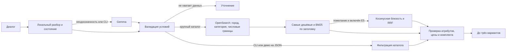

# Avito SmartSet • поиск и результаты эксперимента

На синтетическом каталоге из 10 млн записей один клиент получил три комплекта за 84,8 мс на P95 при выключенном request cache OpenSearch. При восьми клиентах P95 достиг 335 мс, пропускная способность составила 29 запросов/с. Эти замеры включают обращение Python к индексу, валидацию и сборку комплекта. Отдельный HTTP-прогон ниже включает разбор запроса, формирование карточек и сериализацию. Gemma измерялась отдельно.

## Как запустить и показать

Из корня проекта обычное демо запускается через `npm run dev`, открывается на http://127.0.0.1:8765. Для индексированного режима нужны Python 3.10+ и запущенный OpenSearch. На Windows команды ниже выполняются из PowerShell с Docker Desktop и Python в PATH. На macOS и Linux можно использовать python3. Каталог создаётся в новой папке, загрузчик требует свободное имя индекса. Для повторного опыта выберите новые пути. Локальный compose слушает только loopback.

```sh
docker compose -f bench/compose.yaml up -d
python -m bench.catalog ../synthetic --seed 6006 --sizes 10000 100000 1000000 10000000
python -m bench.index ../synthetic/1000000.jsonl.gz smartset-demo
npm run dev -- --index smartset-demo
```

Для гибридного режима установите `python -m pip install -r bench/semantic-requirements.txt` в окружении сервера. Скачайте [model.onnx](https://huggingface.co/intfloat/multilingual-e5-small/resolve/614241f622f53c4eeff9890bdc4f31cfecc418b3/onnx/model.onnx) и [tokenizer.json](https://huggingface.co/intfloat/multilingual-e5-small/resolve/614241f622f53c4eeff9890bdc4f31cfecc418b3/onnx/tokenizer.json) в одну папку. Запустите `python -m buyer.demo --index smartset-demo --semantic-model ../semantic-model` тем же Python. Установка модели нужна только для этого режима. Для запросов к Gemma настройте переменные из [инструкции команды](README.md).

На защите откройте демо и введите «Стол шириной до 100 см, кресло и лампа. Таганрог, бюджет 15 тысяч рублей». Сверьте три категории, ширину и сумму в карточке. Затем напишите «Теперь бюджет 8000 рублей» и сравните условия. Для сравнения релевантности запросите «Деревянный стол в Азове, бюджет 8000 рублей». Для демонстрации подмены описания откройте вкладку «Проверка защиты». Она работает на двух фиксированных учебных каталогах. Для сдачи используется штатный `./run --catalog …` с обязательным обращением к Gemma.

## Как формируется выдача



Загрузчик проверяет формальные поля каждой записи, пишет NDJSON пакетами и сверяет итоговый счётчик после refresh. Bulk create выявляет дубли ID. Ошибка прерывает сборку нового индекса. Сервис подключается по имени завершённого индекса. Поисковый запрос использует одну агрегацию с отдельными группами категорий и одной версией данных для карточек, цен и счётчиков. Числовые фильтры учитывают дробные границы и неизвестные значения. Ответ с отказом шарда или тайм-аутом считается технической ошибкой.

Без пожеланий достаточно трёх самых дешёвых объявлений каждой категории. У варианта с четвёртым товаром по цене есть минимум три предшественника с заменой в этой категории. Очередь по суммарной цене выдаёт глобальные первые три с устойчивым порядком при равенстве. С текстовым пожеланием добавляем до восьми результатов BM25 по заголовку. В гибридном режиме расширяем ценовой список до 16 и ранжируем объединение с помощью E5 (две CPU-нити, LRU на 2048 векторов). Позиции первых трёх результатов обоих методов объединяются через RRF с константой 60. Полный перебор внутри ограниченного пула максимизирует сумму баллов при общем бюджете, затем минимизирует цену. Оптимальность по релевантности распространяется на этот пул. Формальные пожелания по атрибутам записываются в диалог, в этой версии баллы начисляются за текстовые пожелания категории. И цена, и допустимость определяются только структурированными полями. Описания исключены из текстового индекса и контекста Gemma.

## Условия эксперимента

Apple M2, 8 ядер, 8 ГиБ RAM, Darwin arm64, APFS. OpenSearch 3.3.2, JDK 25, heap 512 МиБ на узел, плагины отключены. Основная серия на одном узле с одним primary, без реплик. Refresh выключен при bulk и установлен в 1 с после загрузки. Seed 6006, вложенные префиксы генератора, три города, повторяющиеся заголовки учебных товаров, цены 100–25000 ₽, часть атрибутов пропущена. Это благоприятный для кэша синтетический корпус. Уникальные тексты и распределение нагрузки реального Avito могут дать другие результаты.

Ниже первичная загрузка по 2000 документов, размер Lucene сразу после refresh, и полная HTTP-задержка с одним клиентом. Для каждой ячейки нагрузки выполнено 150 запросов. Перцентили nearest-rank вычислены по успешным ответам. При сравнении восьми клиентов учитывайте прогрев предыдущими запросами. 93 комбинации города и ширины повторяются, бюджет обрабатывается в Python.

| Записей | Индексация, с | Индекс, МБ | HTTP P50 / P95 / P99, мс | Успешных запросов/с |
|---:|---:|---:|---:|---:|
| 1 000 | 0,98 | 0,20 | 1,99 / 4,83 / 6,32 | 435 |
| 10 000 | 0,68 | 1,91 | 1,89 / 3,81 / 4,93 | 486 |
| 100 000 | 2,87 | 19,1 | 3,40 / 5,42 / 8,63 | 310 |
| 1 000 000 | 21,05 | 158,5 | 8,61 / 11,71 / 19,10 | 145 |
| 10 000 000 | 230,18 | 2005,8 | 57,06 / 59,83 / 71,15 | 27 |

В параллельном HTTP-прогоне на 100 тыс. и 10 млн было по три клиентских ошибки соединения на 150 запросов. Эти ошибки сохранены в журнале. На 1 млн с восемью клиентами прошло 150/150, P95 13,53 мс. На 10 млн в серии ядра с отключённым request cache прошли 150/150 при восьми клиентах. JVM потребила около 7,22 CPU-ядер и максимум 647 МБ RSS по выборочным наблюдениям этой серии. CPU из коротких окон зависит от частоты обновления статистики JVM. Полные значения CPU, RSS, heap, RPS, ошибок, тайм-аутов, времени OpenSearch took и клиентских перцентилей доступны [по каждому прогону](../bench/results/load.jsonl).

### Выбор настроек

* На 100 тыс. пакет 4000 дал 2,08 и 2,13 с против 2,54 и 2,58 с для 1000. Загрузчик по умолчанию использует 4000. Пакет 200 дал 5,37 и 5,67 с.
* Три шарда на одном узле снизили P95 одиночного запроса с 2,67–2,76 до 1,91–2,22 мс. При восьми клиентах один шард дал 1528–1571 запрос/с, три шарда 1061–1149. Для локального демо выбран один шард. [Два повтора в обратном порядке](../bench/results/tune.jsonl).
* На двух процессах одного M2 испытана реально назначенная реплика. При восьми клиентах серия 0 → 1 → 0 реплик дала 522 → 981 → 1025 запросов/с. Прирост относительно прогретого контроля не подтверждён. Для доступности при отказе машины нужна реплика на другом хосте. [Замеры](../bench/results/replicas.jsonl).
* Кэшируемый запрос агрегирует кандидатов независимо от бюджета, поэтому смена бюджета переиспользует выборку. В опыте на 100 тыс. при восьми клиентах P95 ядра составил 30,18 мс без request cache и 5,94 мс с ним. Ответы клиентам собираются заново. На 1 млн при четырёх параллельных читателях проверены 32 записи с последующим поиском, включая цену, ширину, создание и удаление. После `refresh=wait_for` все проверки увидели актуальный результат. P95 записи до видимости около 1,0–1,05 с. [Результаты изменений](../bench/results/freshness.json).

## Качество и регрессия

12 авторских запросов, 21 объявление, оценки релевантности 0–3. Все методы получили одинаковые допустимые документы. Recall@3 измеряет долю размеченных релевантных товаров в первой тройке, nDCG@3 учитывает порядок и оценку. Это оценка ранжирования после определения категории. Синонимы выбраны вручную по предметной области, независимого внешнего теста качества нет.

| Метод | Recall@3 | nDCG@3 |
|---|---:|---:|
| По цене | 0,236 | 0,139 |
| BM25 | 0,778 | 0,823 |
| BM25 с синонимами | 0,889 | 0,897 |
| E5 по всем допустимым заголовкам небольшого корпуса | 0,931 | 0,958 |
| Рабочий гибрид BM25 + E5 | 0,972 | 0,939 |

Пример смыслового пропуска — «с питанием от ноутбука» для заголовка «Лампа с USB». Векторный режим включается явно. В прогретом повторе 12 пожеланий на 1 млн медиана составила 12,33 мс для BM25 с синонимами и 12,83 мс для гибрида, на 10 млн — 32,18 и 30,05 мс. Этот короткий последовательный опыт не устанавливает эквивалентность под нагрузкой. [Разметка и ответы](../bench/results/final-quality.jsonl) · [Векторный эксперимент](../bench/results/vector.jsonl) · [Замеры с пожеланиями](../bench/results/hybrid-load.jsonl).

Прошли 31 модульная проверка, 20/20 реальных сценариев CLI с Gemma, 150 сравнений тройки по цене с полным перебором и 150 проверок идентичного ответа после подмены описаний. [CLI](../bench/results/live.txt) · [Проверка оптимальности](../bench/results/oracle.txt) · [Время самого вызова Gemma](../bench/results/llm.json).

## Повтор измерений

Выполняйте из корня. Для каждой размерности создайте отдельный индекс. В исходной серии использован `--batch 2000`. Перед нагрузочным тестом проверьте, что завершился refresh и в индексе нужное число документов. Для выборки JVM RSS на macOS передайте `--pids PID`. Результаты пишутся в stdout. Сценарий freshness предназначен для синтетического индекса с ценами от 100 ₽.

```sh
python -m bench.index ../synthetic/10000000.jsonl.gz smartset-large --batch 2000
python -m bench.load smartset-demo smartset-large --workers 1 8 --n 150
python -m bench.tune ../synthetic/100000.jsonl.gz
python -m bench.freshness smartset-demo
python -m bench.oracle
python -m bench.quality --model ../semantic-model
python -m bench.vector ../semantic-model
python -m bench.hybrid_load ../semantic-model smartset-demo smartset-large
python -m unittest discover -v
python -m tests.live
python -m bench.llm
```

Для прогона `python -m bench.replicas ../synthetic/100000.jsonl.gz` запустите два data-узла с одинаковым cluster.name, отдельными каталогами данных, портами транспорта и discovery.seed_hosts первого узла. Уберите discovery.type=single-node. Тест дожидается green и проверяет число активных копий. [Официальная инструкция запуска OpenSearch](https://docs.opensearch.org/latest/install-and-configure/install-opensearch/tar/).

После увеличения очереди HTTP-сервера до 64 соединений повтор при восьми клиентах прошёл без ошибок на 100 тыс. и 10 млн (по 150 запросов). На 10 млн HTTP P50/P95/P99 в повторе составили 286/387/454 мс при 39,8 успешных запросах/с. К этому моменту в кластере работал второй процесс и состояние кэшей изменилось. Разница в задержке между сериями не позволяет приписать весь эффект изменению очереди. [Полный повтор](../bench/results/recheck.jsonl).

В отдельной серии из десяти последовательных вызовов Gemma получены P50 2,64 с и P95/P99 3,73 с, ошибок 0. Число наблюдений для хвостовых перцентилей мало. [Исходная архитектура и сравнение технологий](SEARCH_DESIGN.md).
